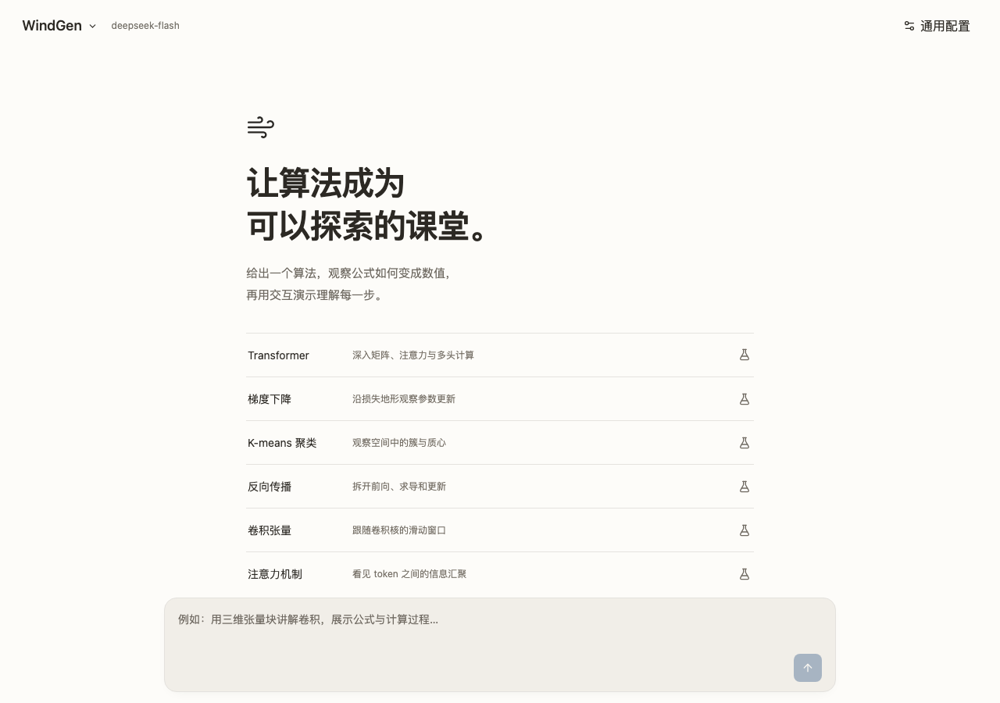

# WindGen

[](https://www.python.org/downloads/release/python-3120/)
[](https://www.typescriptlang.org/)

用对话生成可操作的机器学习教程：公式、中间数值、本地计算与按需三维场景。Python 3.12 + uv + python-dotenv；React + TypeScript + shadcn/ui + Three.js。



## 启动

```bash
uv sync
cd frontend
npm ci
npm run build
cd ..
uv run windgen
```

打开 http://127.0.0.1:8787 。首页六个固定教学样例无需 API 密钥，包括 Transformer、梯度下降、K-means、小型网络反向传播、卷积张量与注意力空间节点。

从源码目录运行；SQLite 数据保存在 `data/`。Python 服务默认只监听本机。浏览器需要支持 WebGL 和 Worker，建议使用较新的 Chrome、Edge 或 Firefox。无 WebGL 时仍可查看公式、源码和数值。

## 配置真实模型

点击页面右上角「通用配置」→「模型服务」，在居中弹窗中选择 DeepSeek 或自定义 OpenAI 兼容接口，填写基础地址、模型 ID 与 API Key。「测试连接」查询模型列表；「保存配置」写入本机 `.env` 并立即应用，后续生成无需重启。已有密钥不会回填到页面，同一接口留空可保留；切换接口需填写对应服务的密钥。

也可以手动配置：

复制 `.env.example` 为项目根目录 `.env`，填写：

```dotenv
LLM_BASE_URL=https://api.deepseek.com
LLM_MODEL=deepseek-flash
LLM_API_KEY=你的密钥
```

手动编辑后重启 Python 服务。DeepSeek 使用 OpenAI 兼容 `/chat/completions` 流式接口。其他兼容服务修改基础地址和模型名即可；基础地址不要包含 `/chat/completions`。已保存的密钥只由后端读取；页面可输入新密钥，但不会获得已有密钥。

`.env` 通过明确路径加载，已有进程环境变量优先。可选配置见 `.env.example`。默认模型名来自调研时的 DeepSeek 官方文档，模型可用性由配置决定。

## 使用

- 首页选择固定样例，可以单步、播放/暂停、重置、修改参数。
- 「Transformer」使用 6 个 token、4 维表示、2 个头的合成教学数据；切换七个计算阶段，选择头与 Query、调整温度和因果掩码，点选真实矩阵、注意力热力图与二维 token 连接。继续追问与自动纠错需配置真实模型，详见 [交互教学组件与 Transformer 样例](docs/intelligent-ui.md)。
- 三维场景拖动旋转、滚轮缩放、点击对象检查标识和数值；“复位视角”恢复观察角度。
- 输入算法需求会调用真实模型。系统会区分闲聊与教程请求；闲聊直接对话，教程内容边生成边渲染。出现计算错误时自动尝试修正。后续提问包含当前演示和最新参数状态。
- 新回答更新当前演示，对话栏可查看历史回答。普通修改保留参数；显式修改参数可通过生成文档的状态指令重置进度。
- “源码”展示 DIL 文档与解析诊断；“状态”显示进入下一轮的状态快照。
- 侧栏会话旁的垃圾桶可删除单条会话，底部「删除全部会话」可清空历史。两者均需确认，并一起删除对应版本；生成中不可删除。删除当前会话后回到新教程。
- 固定样例明确标识，继续提问需要真实模型配置，不会用固定样例冒充真实生成。

## 开发与验证

分别运行两个终端：

```bash
uv run windgen
```

```bash
cd frontend
npm run dev
```

开发页面 http://127.0.0.1:5173 自动代理 Python API 与沙箱页面。

```bash
uv run pytest -q
uv run ruff check src tests
cd frontend
npm test
npm run build
npx playwright install chromium
npm run test:browser
```

浏览器测试需要上述两个服务已启动。覆盖实际三维控件、连续动画、闲聊路由、早期流式渲染、自动纠错、手机布局、浏览器隔离、禁止联网与超时。

## 结构

```text
src/windgen/      Python API、模型流、会话存储、系统提示词
frontend/src/    TypeScript 界面、编译 Worker、沙箱客户端与受控渲染
examples/        独立教学 DIL 样例（明确演示用途）
tests/          Python API 与模型适配器测试
docs/           调研、访谈、MVP、协议与实际验证
```

生成程序不在 Python 或主页面执行。文档由独立编译 Worker 解析，经 opaque-origin iframe 内的 Worker 执行，宿主仅渲染校验后的组件树和几何数据。使用严格 CSP 和执行超时；浏览器沙箱不是操作系统级资源隔离，不提供任意代码、无限数据或 GPU 训练环境。

## 文档与来源

- [MVP 范围](docs/mvp.md)
- [交互文档与场景协议](docs/protocol.md)
- [实测与限制](docs/verification.md)
- [核心研究](docs/research/generative-ui.md)
- [参考源码研究](docs/research/reference-source.md)
- [算法数学与数值核验](docs/research/algorithm-teaching.md)

受 [Disdjj/intelligent-ui-demo](https://github.com/Disdjj/intelligent-ui-demo) 启发，复用其 MIT 编译器的解析与恢复逻辑并迁移为浏览器 ES Modules，语法校验改为 Acorn。复用部分保留在 `frontend/src/compiler/vendor/`，许可见 `THIRD_PARTY_LICENSES/intelligent-ui-demo.txt`。宿主界面、三维渲染、运行时、Python 服务与教学样例为 WindGen 实现。这里实现的是独立交互模式，不宣称兼容全部 ChatGPT 内部协议。
